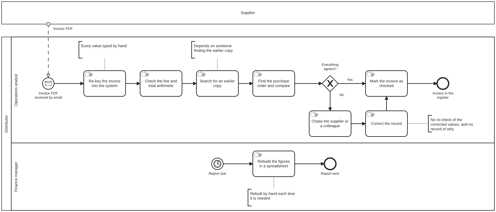
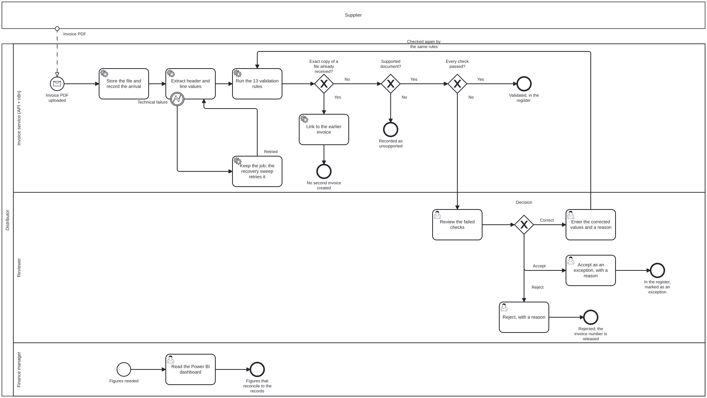

# Process maps

Two BPMN 2.0 maps: how supplier invoices are handled without this service, and
how they are handled with it, as built. The `.bpmn` files open in any BPMN
modeller (Camunda Modeler, bpmn.io, Bizagi); the pictures below are rendered
from those files by bpmn-js, so the picture and the file cannot disagree.

Both are generated by `tools/build_process_maps.py` and checked by
`tests/unit/test_process_maps.py`, which fails if a committed map no longer
matches its spec, if a step can't be reached or leads nowhere, if a decision
has an unlabelled branch, or if a picture is missing an element of its map. To
change a map, edit the spec in the script and run it with `--render`.

## As-is: supplier invoices today

[`process/as_is.bpmn`](process/as_is.bpmn)

Drawn from the process described in [business_requirements.md](business_requirements.md).
The distributor is invented, so this is the process as the requirements
describe it, not one observed in a real company. The annotations mark the
problems the requirements were written to solve:

- **Every value is typed by hand.** Re-keying is where transcription errors
  come from, and it is the step that grows with volume.
- **Duplicate detection depends on memory.** Someone has to think to search,
  and to find the earlier copy when they do.
- **A correction leaves no trace.** The record is changed, the arithmetic is
  not checked again, and nothing records why.
- **Reporting starts from scratch each time.** Figures rebuilt in a spreadsheet
  can't be traced back to the records they came from.

## To-be: supplier invoices with the service

[`process/to_be.bpmn`](process/to_be.bpmn)

This shows what the code does, which is not quite what a first plan would draw.
An identical file is not stopped on arrival: the service stores it, extracts
it, and catches it with `EXACT_FILE_DUPLICATE` when all thirteen rules run
together. It is then linked to the earlier invoice, so no second invoice or
revision is created. `tests/integration/test_pdf_pipeline.py` checks exactly
that: one invoice, one revision, two documents.

What a reader should take from it:

- **The rules run once per version, whoever produced it.** A reviewer's
  correction goes back through the same thirteen rules as an extracted value
  does. A correction cannot slip a figure past a check.
- **Only the cases that need judgement reach a person.** Everything else ends
  in the register, as unsupported, or linked as a duplicate.
- **Every decision needs a reason.** Correct, accept as an exception, and
  reject all require one, and the database refuses an empty reason.
- **An accepted exception is not a pass.** It enters the register marked as an
  exception and is excluded from the straight-through rate.
- **A technical failure keeps the work.** The stored file, the event history
  and a retryable job survive, and the recovery sweep tries again.

### Where the map simplifies

- The failure event is drawn on extraction because that is where a missing or
  unreadable file surfaces. A failure anywhere in processing is handled the
  same way.
- Retries are bounded. When the last attempt fails, the job is left for a
  person rather than retried forever. The map shows the retry, not the limit.
- Uploading and processing are separate requests in the service, with n8n
  triggering the second over a webhook. The map draws them as one lane,
  because to the business they are one step.
- A notification is written to an outbox when a case needs review, but
  nothing delivers it yet. The reviewer works from the review queue, so the
  map shows no notification.

## What changed

| As-is problem | To-be response | Requirement | Evidence |
|---|---|---|---|
| Values re-keyed by hand | Extracted, each keeping its page and source line | 2 | `tests/integration/test_pdf_pipeline.py` |
| Duplicates found by memory | Exact copies caught by rule, linked, enforced by database constraints | 5 | `tests/integration/test_pipeline.py` |
| Arithmetic checked by eye | Thirteen rules, each with an exception code and its own test | 3 | `tests/unit/test_rules_*.py` |
| Corrections not re-checked, reasons not kept | Corrections re-run every rule; reason required; every revision kept | 4 | `tests/integration/test_review.py` |
| Reports rebuilt by hand | SQL views and a Power BI report, reconciled to the base tables by a script | 7 | `tools/reconcile_dashboard.py` |

The user stories behind each row, with acceptance criteria and the tests that
verify them, are in [user_stories.md](user_stories.md).

## Not on either map

Scanned documents (there is no OCR), notification delivery, payment, and any
posting to a ledger. The first two are not built. The last two are outside
this project's scope by design.
